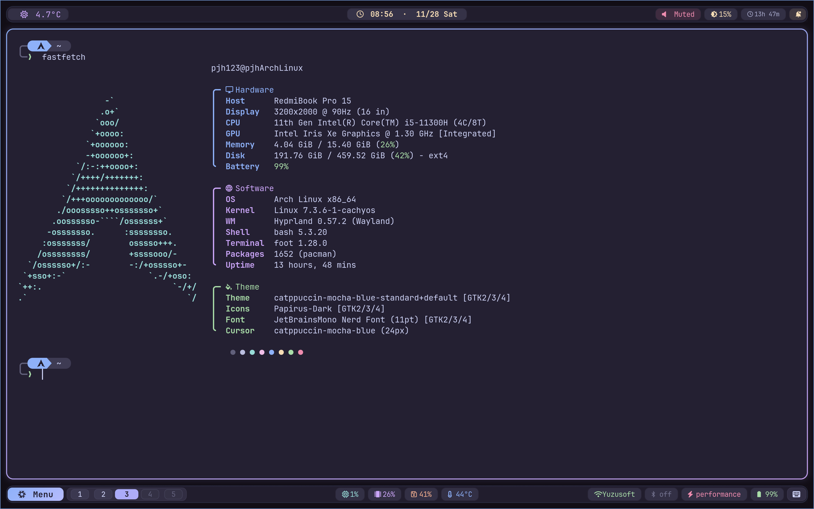

# Hyprland Dotfiles

English | [中文文档](docs/README-zh.md)

My personal Arch dotfiles: Hyprland setup with systemd user service
management, plus shell and editor-adjacent configs.



## Architecture

Services are managed via `systemd --user`:

- `hyprland-session.target` — session lifecycle target
- `hyprland.lua` runs `~/.config/hypr/scripts/init.sh` on startup (via the `hyprland.start` event)
- `init.sh` imports Wayland env vars into systemd, then starts `hyprland-session.target`
- All daemons (`waybar`, `swaync`, `hyprpaper`, `hypridle`, `fcitx5-daemon`, `power-profile`, `hyprland-guard`) bind to this target via `BindsTo=` / `PartOf=`. `mpv-profile-watch` runs on `default.target` because it only needs D-Bus.

Bluetooth is **on-demand** to save battery: `bluetooth.service` and the radio are off when idle. The waybar Bluetooth module (`dotctl status bt`) shows the current state, and clicking it unblocks rfkill, starts `bluetooth.service` (via the passwordless sudoers rule that `install.sh` sets up), powers the adapter on, and opens `blueman-manager`. The tray applet (`blueman-applet`) is not used.

This means when Hyprland exits, all services are cleaned up automatically.

### Wayland-native policy

Everything that can run on Wayland does, so dialogs and popups are sized and
positioned by the compositor instead of XWayland:

- Qt: `QT_QPA_PLATFORM=wayland;xcb`
- GTK3: `GDK_BACKEND=wayland` (Thunar, pavucontrol, zathura, portal dialogs);
  also imported into the systemd/D-Bus activation environment by `init.sh`
- Firefox: `MOZ_ENABLE_WAYLAND=1`; Chromium: `chrome-flags.conf`;
  QQ: `qq-flags.conf`; other Electron apps: `ELECTRON_OZONE_PLATFORM_HINT=auto`
- Steam/Proton, Wine and a few SDL games intentionally stay on XWayland.

## Installation

Tested on Arch / CachyOS and Debian (testing).

```bash
git clone https://github.com/pjh456/dotfiles ~/dotfiles
~/dotfiles/install.sh --packages
```

By default `install.sh`:

- backs up any existing dotfiles to `~/.dotfiles-backup-<timestamp>/`, then
  uses `dotctl install` to copy everything from `etc/` into `$HOME` as
  regular files (backup, manifest and pruning live in Rust);
- installs the pinned `dotctl` release into `~/.local/bin` (checksum-verified;
  `--no-cli` leaves an existing binary alone, `--cli-from-source` forces a
  local build);
- enables the session services whose binaries are installed (`systemctl --user`);
- writes the NOPASSWD sudoers rule for on-demand bluetooth (`systemctl`
  start/stop plus `rfkill unblock`) and remembers it, so re-runs don't ask
  for a password;
- installs a udev rule giving the `video` group write access to
  `/sys/class/backlight/*/brightness`, so `brightnessctl` works without sudo
  (the user is added to `video` if needed; a new login may be required);
- comments out the volume/brightness commands in `/etc/acpi/handler.sh` (only
  if `acpid` is installed), so acpid and Hyprland's media-key binds don't run
  the same key twice.

Options:

| Option | Effect |
|---|---|
| `--packages` | Also install the required packages — official repos via `pacman` (Arch) or `apt` (Debian), AUR via your `yay`/`paru`/`buttercup` if one is present; on Debian the manual-build packages are printed instead. Lists live in [`packages/`](packages/), validated by CI against the live databases. |
| `--no-<pkg>` | With `--packages`: do not install package `<pkg>`. The name must exist in the detected distro's package lists — unknown names are rejected. |
| `--restore [DIR]` | Undo a deployment: remove the deployed files (tracked in `~/.dotfiles-deployed`) and restore the backed-up originals from `DIR` (default: newest `~/.dotfiles-backup-*`). Systemd enabling, the sudoers rule and the acpid patch are not rolled back. |
| `--with-cli` | Install/update `dotctl` (default). Downloads the pinned `dotctl-v<version>` release and verifies `SHA256SUMS`; falls back to `cargo build` if needed. |
| `--cli-from-source` | Build `dotctl` locally instead of downloading the release. |
| `--no-cli` | Do not install/update `dotctl`; use an existing binary or `DOTCTL_BIN` (the installer itself needs one). |
| `--no-systemd` | Skip `daemon-reload` and enabling the session services. |
| `--no-sudo` | Skip the system-level tweaks: the bluetooth sudoers rule, the backlight udev rule and the acpid media-key patch. |
| `-h`, `--help` | Show usage. |

Companion packages are excluded together: `--no-tlp` also excludes
`tlp-pd`.

The script is idempotent — re-running it is safe.

Before the first run, make sure these `pass` entries exist (`.bashrc` reads
them at shell startup): `snyk/token`, `huggingface/token`.

### Debian notes

On Debian, `--packages` installs [`packages/debian.txt`](packages/debian.txt)
via `apt` and prints the packages that need a manual build. Debian stable
(trixie) predates hyprland in main — use testing, or stable with
trixie-backports. Two specifics:

- `tlp` conflicts with `power-profiles-daemon`. The waybar
  `power-profiles-daemon` module (and the `dotctl watch power` service) need the
  `net.hadess.PowerProfiles` D-Bus interface, which tlp 1.10 provides
  built-in — enable it with `TLP_PD_ENABLE=1` in `/etc/tlp.conf`.
- Arch's `fcitx5-gtk` is `fcitx5-frontend-gtk3` / `fcitx5-frontend-gtk4`
  on Debian.

#### Manual builds (Debian)

No Debian package exists for these; build from source:

| Package                        | Source                                                        |
| ------------------------------ | ------------------------------------------------------------- |
| hypridle                       | https://github.com/hyprwm/hypridle                            |
| hyprlock                        | https://github.com/hyprwm/hyprlock                            |
| hyprpaper                       | https://github.com/hyprwm/hyprpaper                           |
| hyprswitch                      | https://github.com/hyprwm/hyprswitch                          |
| swaync                          | https://github.com/elkowar/swaync                             |
| fonts-jetbrains-mono-nerd       | https://github.com/nerd-fonts/nerd-fonts (install script)     |
| rofi-emoji                      | https://github.com/Mange/rofi-emoji                           |

Then start Hyprland:

```bash
start-hyprland
```

Every start restarts `hyprland-session.target`, so the daemons re-attach to the new compositor's Wayland socket. After a crash-and-restart a service can still look `active` while its connection is already dead — `fcitx5` in particular then loses the input method silently, so starting only the inactive units is not enough. `init.sh` also exits early when the Hyprland instance that launched it is already gone (a fast restart can leave it orphaned).

## Day-to-day

The repo's `etc/` is the source of truth; `$HOME` holds regular copies.
Edit files in the repo, then re-run `~/dotfiles/install.sh` to apply —
up-to-date files are left alone, changed ones are re-copied. Edits made
directly in `$HOME` do not reach the repo; copy them back into `etc/`
before committing if you want to keep them.

## Rollback

```bash
~/dotfiles/install.sh --restore            # from the newest backup
~/dotfiles/install.sh --restore <dir>      # or a specific ~/.dotfiles-backup-*/
```

Removes the deployed files (tracked in `~/.dotfiles-deployed`) and
restores the backed-up originals. Not rolled back: systemd service
enabling, the sudoers rule.

## Keybindings

| Key                   | Action                                           |
| --------------------- | ------------------------------------------------ |
| `Super + Return`      | Open foot terminal                               |
| `Super + Q`           | Close window                                     |
| `Super + Space`       | Rofi application launcher                        |
| `Super + .`           | Color emoji picker (inserts into the focused window; copies to the clipboard when `wtype` is not installed) |
| `Super + L`           | Power menu (shutdown/reboot/lock/suspend/logout) |
| `Alt + Tab`           | Hyprswitch window switcher                       |
| `Super + V`           | Clipboard history (cliphist + rofi)              |
| `Super + W`           | Weather popup (same 7-day forecast as clicking the top-left Waybar module) |
| `Super + N`           | Toggle notification center (swaync)              |
| `Super + F5`          | Reload Hyprland + restart Waybar                 |
| `Ctrl + Alt + A`      | Screenshot region (grim + slurp)                 |
| `Super + F`           | Fullscreen                                       |
| Waybar Bluetooth icon | Click: start `bluetooth.service` + power on adapter, then open `blueman-manager` (no-op if already on) |
| `Super + 1-5`         | Switch workspace                                 |
| `Super + Shift + 1-5` | Move window to workspace                         |
| `Super + R`           | Resize mode (arrow keys to resize)               |
| `XF86Audio*` / `XF86MonBrightness*` | Volume / brightness OSD popup (swaync) |

## dotctl

The desktop helpers are one Rust binary at `~/.local/bin/dotctl`. Waybar,
the Hyprland keybinds, hypridle and the systemd user units all call it; the
old shell scripts are gone.

`install.sh` installs the pinned `dotctl-v<version>` release from GitHub
(a static x86_64 musl binary), verifies `SHA256SUMS`, and falls back to a
local `cargo build` if the download is unavailable. Use `--no-cli` to leave
the installed binary alone (the installer still needs an existing one or
`DOTCTL_BIN`), or `--cli-from-source` to force a local build.

The hot paths avoid the old process fan-out: `status temp` reads hwmon
directly (~0.5ms instead of ~20ms for `sensors | awk`), `status bt` never
spawns `bluetoothctl` (which can block for minutes when the service is
stopped), and the mpv/power watchers are event-driven instead of polling.

### Run manually

| Command | What it does |
|---|---|
| `dotctl wallpaper set <image>` | Set the wallpaper from any file (through `hyprpaper`) |
| `dotctl wallpaper unset` | Back to the solid-black wallpaper (keeps hyprpaper alive) |
| `dotctl menu power` | Rofi power menu — also `Super + L`; a second press closes it |
| `dotctl menu clipboard` | Rofi clipboard history with a "copied" notification and `--paste-once` |
| `dotctl menu emoji [--paste]` | Color emoji picker; `--paste` copies and sends Ctrl+V (used for QQ) |
| `dotctl rofi -show drun` | Toggle any rofi menu: open it, or close it when already open |
| `dotctl mpv [profile]` | Force-sync `mpv.conf.{PRF,BAL,SAV}` → `mpv.conf` now |
| `dotctl reload waybar` | Restart Waybar after editing its config |
| `dotctl on-battery` | Exit 0 only while on battery (hypridle one-liners) |
| `dotctl doctor` | Check hwmon, D-Bus, Hyprland socket and external commands |
| `dotctl guard --once` | Probe Hyprland liveness once; `dotctl guard` runs the log mirror |
| `dotctl install --repo-root ~/dotfiles` | Deploy `etc/` into `$HOME` (normally called by `install.sh`) |
| `dotctl restore [DIR]` | Undo a deployment (normally called by `install.sh --restore`) |

### Invoked by the configs

| Command | Invoked by |
|---|---|
| `dotctl status temp` | Waybar temperature module (5s poll) |
| `dotctl status bt`, `dotctl bt toggle` | Waybar Bluetooth module (5s poll + click) |
| `dotctl weather`, `dotctl weather --forecast` | Waybar weather module (30 min poll) / `Super + W` |
| `dotctl osd volume up\|down\|mute`, `dotctl osd brightness up\|down` | Hyprland media keys |
| `dotctl menu clipboard\|emoji\|power\|launcher` | `Super + V`, `Super + .`, `Super + L`, `Super + Space` |
| `dotctl watch mpv` | `mpv-profile-watch.service` (zbus PropertiesChanged) |
| `dotctl watch power` | `power-profile.service` (inotify on AC state) |
| `dotctl guard` | `hyprland-guard.service` (log mirror + hang capture) |

### Development

```bash
cargo test --manifest-path dotctl/Cargo.toml
cargo clippy --manifest-path dotctl/Cargo.toml --all-targets -- -D warnings
```

Bump `dotctl/Cargo.toml`, tag `dotctl-vX.Y.Z`, and push the tag. The release
workflow builds a static x86_64-musl binary, verifies the tag/version match,
publishes `SHA256SUMS`, and smoke-tests the asset in an Arch container.

## File Structure

```
├── install.sh                 # Deploy / restore entrypoint
├── dotctl/                    # Rust CLI (single static-musl binary)
│   ├── Cargo.toml
│   └── src/
├── docs/
│   └── README-zh.md           # Chinese documentation
├── packages/
│   ├── arch-official.txt      # pacman list (validated by CI)
│   ├── arch-aur.txt           # AUR list (yay/paru/buttercup)
│   ├── debian.txt             # apt list (validated by CI)
│   └── debian-manual.txt      # Debian manual-build list
├── etc/                       # 1:1 mirror of $HOME (copied into place by install.sh)
│   ├── .bashrc                # Aliases, starship, fzf, thefuck
│   ├── .bash_profile
│   ├── .gitconfig
│   ├── .config/
│   │   ├── chrome-flags.conf  # Chromium/Electron: wayland native + Intel VA-API
│   │   ├── qq-flags.conf      # QQ: native Wayland (avoids XWayland dialog sizing)
│   │   ├── starship.toml      # Catppuccin two-line prompt
│   │   ├── fastfetch/         # Grouped system info card
│   │   ├── btop/              # Catppuccin theme, transparent background
│   │   ├── hypr/              # hyprland.lua (+anim/keys/notify), hypridle, hyprlock, hyprpaper, scripts/init.sh
│   │   ├── waybar/            # Status bar config & style
│   │   ├── rofi/              # Launcher config
│   │   ├── swaync/            # Notification center config & style
│   │   ├── fcitx5/            # Input method config
│   │   ├── foot/              # Terminal config
│   │   └── systemd/user/      # Session services (*.wants/ not tracked)
│   └── .local/share/
│       └── fcitx5/themes/     # Self-contained fcitx5 theme (svg + png)
└── .github/workflows/         # shellcheck/JSON/install tests + dotctl CI/release
```
